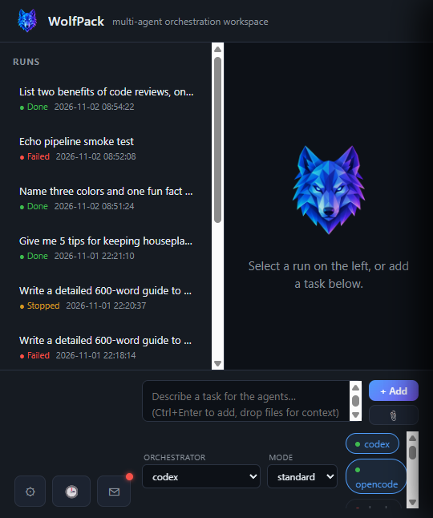
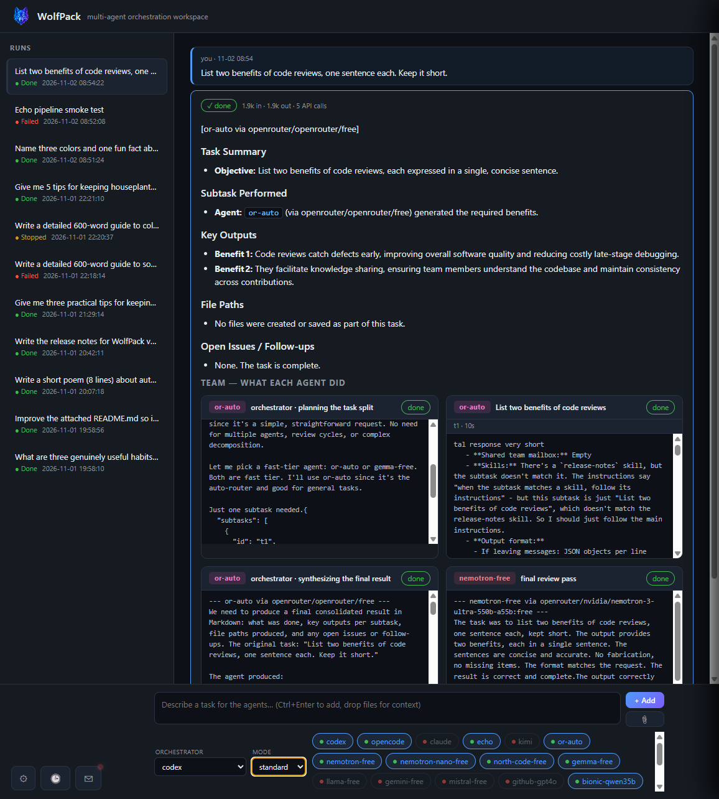

# 🐺 WolfPack

**Pull every free AI model on the internet into one place — and make them work as a team.**

WolfPack is a local-first multi-agent harness. It pools free cloud tiers
(OpenRouter, Groq, Gemini, GitHub Models, Mistral, Cerebras), unlimited local
models (Ollama, LM Studio, Bionic), cheap APIs (DeepSeek, Moonshot) and any
agent CLIs you already pay for (Claude Code, Codex, OpenCode) into a single
roster — then an orchestrator decomposes your task, delegates to the
best-suited agents, lets them talk to each other, and hands you back a
finished result. You watch it all happen in a live dashboard.

Zero Python dependencies (stdlib only, 3.11+). MIT licensed. Current
release: **v1.1.0** (see `VERSION`).




## The free compute pool

The point of WolfPack is simple: **there is far more free AI compute
available than any one app lets you use.** One key per provider unlocks many
models; local servers are unlimited; and WolfPack routes around rate limits
automatically, so a 429 on one free model just moves the work to another.

| Source | Cost | What you get |
|---|---|---|
| Ollama / LM Studio / Bionic | free, unlimited | every local model you have, fully private |
| OpenRouter | free key | dozens of `:free` models from one key |
| Groq | free key | very fast Llama / Gemma / Mixtral |
| Gemini (AI Studio) | free key | Gemini Flash free tier, huge context |
| GitHub Models | free with any GitHub account | GPT-4o family, Llama, Phi, Mistral |
| Mistral | free key | free experiment tier |
| Cerebras | free key | ultra-fast Llama inference |
| OpenCode CLI | free, no key | built-in free Zen models |
| DeepSeek / Moonshot | cheap paid | strong reasoning/coding when free isn't enough |
| Claude Code / Codex / OpenCode CLIs | your subscriptions | full agents with file access, not just models |

The scoreboard keeps the story honest: per-agent success rates, speed and
token counts, plus a **cost counterfactual** — what this week's free-pool
work would have cost on a frontier paid API ("≈ $X done by the free pool").

## What it does

**Orchestration modes.** *Standard* — the orchestrator plans, splits and
delegates with dependency edges, then synthesizes. *Council* / *best-of-n* —
every selected agent answers independently and a judge scores each answer
1–10, rendering a leaderboard above the merged verdict. *Project* — for big
builds (games, apps, tools): a lead agent works like a real developer in a
`project/` folder — plan, build real files, run them, fix what breaks —
looping up to three build-test-fix cycles while delegating side work to
cheap fast models.

**Agents that actually coordinate.** A shared mailbox lets agents leave
findings for each other; dependent subtasks automatically receive prior
results; capability tiers (strong / fast) keep review and finalize steps on
your best models while drafts go to fast ones. Drag files onto the window
and every agent gets them as context.

**Runs you can trust.** Provider-aware failover (account-wide rate limits
sink one provider's models together, so retries route to a *different*
provider first — for subtasks, the planner, the judge and synthesis alike).
Hung workers are cut loose instead of stalling the team. A stop button
cancels cleanly. An optional final review pass has a different strong agent
critique the result; in project mode a second agent verifies the "done"
claim against the files actually on disk.

**Scheduled tasks.** Recurring tasks on your local timezone with add/delete,
per-schedule agents and mode, delivery to a folder, the mailbox, or a
webhook, quiet mode for routine checks (`HEARTBEAT_OK` suppresses noise),
and catch-up choices for when WolfPack was closed at fire time.

**Conversation threads.** Every run's full context stays on disk. Follow-ups
inherit it (CLI agents resume their actual sessions), nest under the
original task in the sidebar, and render as a chronological conversation.
Result cards link straight to the real local file or folder — nothing to
download.

**Quality of life.** First-run setup wizard links everything with per-item
skip; live re-probing picks up new local models without a restart; team
memory carries durable facts between runs; token telemetry and budget guards
pause a run before it overspends; 👍/👎 ratings feed an auto-orchestrator
that hands the lead role to whichever strong agent actually performs best;
task pipelines chain up to five follow-up steps automatically; presets turn
a task + line-up into a one-click chip; browser notifications fire on finish.

**Plays well with others.** Skills support — scan skills already installed
for your other agents, download community SKILL.md packs (arrive disabled,
with provenance), or save a finished run as a reusable skill. An inbound MCP
endpoint (`POST /mcp`) lets other agent apps delegate work to the pack.
Export/import packs your whole setup (agents, schedules, skills, memory —
never keys) into one zip.

## Install & start

Requires **Python 3.11+** (stdlib only — nothing to pip install) and
optionally **Node.js** for the CLI agents.

```bash
# Windows — double-click start.bat (checks Python, starts the server,
# opens the dashboard). One-time CLI agent installs: install.bat
start.bat

# macOS / Linux
./start.sh        # one-time CLI agent installs: ./install.sh
```

On first open, the **setup wizard** lists everything not yet linked — paste
free keys in place (or jump to the signup page), test local servers, open
sign-in terminals for CLI agents. Every item has a skip; the wizard reopens
anytime from Settings → Setup wizard.

No keys at all? The built-in `echo` agent lets you try the whole
orchestration flow for free.

## Use

The dashboard: type a task, pick agents, press **+ Add** (or Ctrl+Enter) —
several tasks can run at once. Unlinked agents start disabled — click one to
open its link popup (signup link, key paste, connection test, all in place).
The ⚙ Settings panel (collapsible sections) holds the default orchestrator,
parallelism, budget guards, per-agent model picker and tier overrides, the
skills manager, provider keys, and disk hygiene for the runs archive.

The ✉ Mailbox shows agent-to-agent messages, questions addressed to you
(approval gates pause a run until you answer inline), and scheduled results.
The 🕒 clock panel manages scheduled tasks.

Or headless, from the CLI:

```bash
python harness.py run "Research the top 3 Python web frameworks and compare them"
python harness.py run "..." --agents codex,or-auto,gemini-free --orchestrator codex
python harness.py run "..." --pattern council   # everyone answers, judge merges
python harness.py run "..." --pattern project   # lead builds & tests real files

python harness.py agents     # roster + status
python harness.py doctor     # headless health check for every agent
python harness.py discover   # today's actually-free models, live from providers
python harness.py discover openrouter --add 10   # append 10 to agents.toml
python harness.py show <run_id>                  # reprint a past result
```

## How it works

1. **Plan** — the orchestrator gets your task plus the agent roster and
   returns a JSON plan: subtasks, assigned agents, `depends_on` edges. If
   the plan doesn't parse, a different strong-tier agent retries before the
   run fails. (Council/best-of-n skip planning.)
2. **Delegate** — independent subtasks run in parallel, each agent in its
   own workdir under `runs/<run_id>/agents/<id>/`. Batches are time-capped.
3. **Talk** — prompts include the shared mailbox; agents reply via
   `outbox.jsonl`, merged into `mailbox.jsonl` for everyone downstream.
   A message with `"type": "approval"` pauses the run for a user answer.
4. **Synthesize** — the orchestrator consolidates everything into
   `runs/<run_id>/result.md`.
5. **Review** (optional) — a different strong-tier agent critiques; on a
   REVISE verdict the orchestrator rewrites.
6. **Learn** (optional) — durable facts go to `memory/shared/*.md`; future
   runs inject them into every prompt.

## Adding agents

Everything is TOML. A cloud model:

```toml
[agents.my-model]
type = "api"
provider = "openrouter"          # must exist in providers.toml
models = ["vendor/model:free", "vendor/smaller:free"]   # failover order
description = "What it's good at."
strengths = ["coding", "writing"]
status = "ready"
```

A CLI agent:

```toml
[agents.my-cli]
type = "cli"
command = 'mycli run "{prompt}"'  # {prompt} and {workdir} are substituted
stdin = false                      # or true + command ending in '-'
                                  # or promptfile = true + '< "{promptfile}"'
strengths = ["general"]
status = "ready"
```

Prompts are passed safely: `stdin` and `promptfile` modes are fully immune
to shell metacharacters, and `{prompt}` interpolation neutralizes quote
breakout.

A new provider (any OpenAI-compatible endpoint):

```toml
# providers.toml
[myprovider]
base_url = "https://api.example.com/v1"
key_env  = "MYPROVIDER_API_KEY"
paid     = true            # optional — wizard stops calling it "free"
```

## Safety

- **Local-only by default.** The server binds to `127.0.0.1` — a personal
  tool, not a network service. Only pass `--host 0.0.0.0` if you understand
  that anyone who can reach your machine can then drive your agents.
- Each agent works only inside its own run directory.
- `codex` runs under `--sandbox workspace-write`; any CLI agent can opt into
  Docker Sandboxes (`sandbox = true` + the Settings toggle).
- Community skills are prompt-injection vectors: downloads arrive
  **disabled** with a `SOURCE.txt` provenance file. Dropped-in context files
  get a regex tripwire for instruction-like text before agents read them.
- `keys.toml` is git-ignored; keys never leave your machine except to their
  own provider — and are never included in an exported pack.

## Layout

```
wolfpack/
├── start.bat / start.sh # one-click launch (checks Python, opens the UI)
├── VERSION              # release stamp (shown in the UI header)
├── server.py            # web UI + JSON API + MCP endpoint (stdlib only)
├── index.html           # dashboard, no build step
├── harness.py           # orchestrator engine + CLI
├── agents.toml          # agent registry        <- edit me
├── providers.toml       # cloud providers       <- edit me
├── keys.toml.example    # API key template      <- copy to keys.toml
├── install.bat / .sh    # optional CLI installers
├── skills/              # SKILL.md packs (scanned + downloadable + self-written)
├── memory/              # durable team memory: shared/*.md, agents/<name>.md
├── usage.jsonl          # per-call token telemetry
└── runs/<run_id>/       # plan.json, mailbox.jsonl, status.json, result.md
```

## License

MIT — see `LICENSE`. Built to be downloaded, hacked on, and shared.
